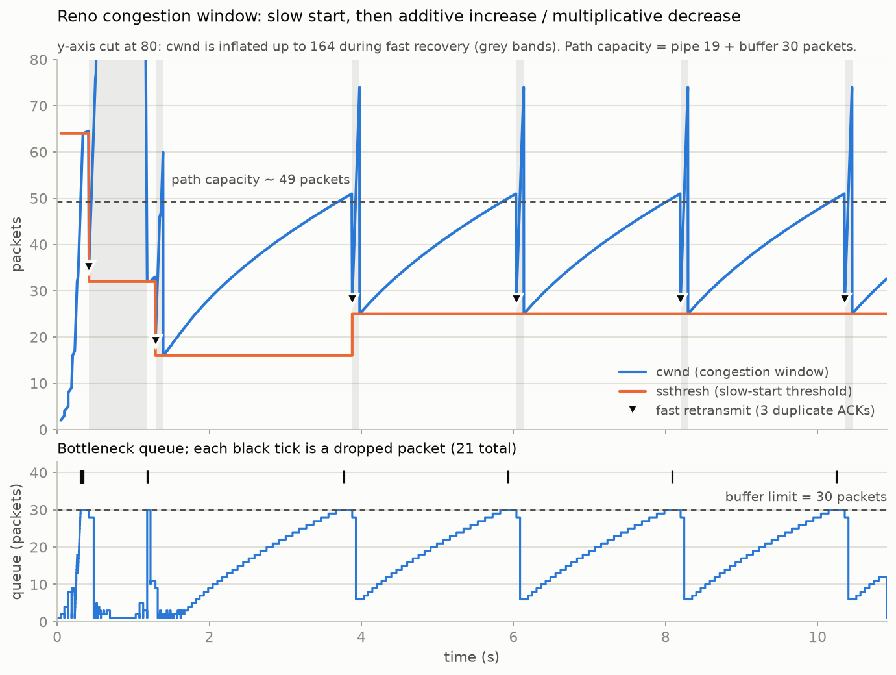
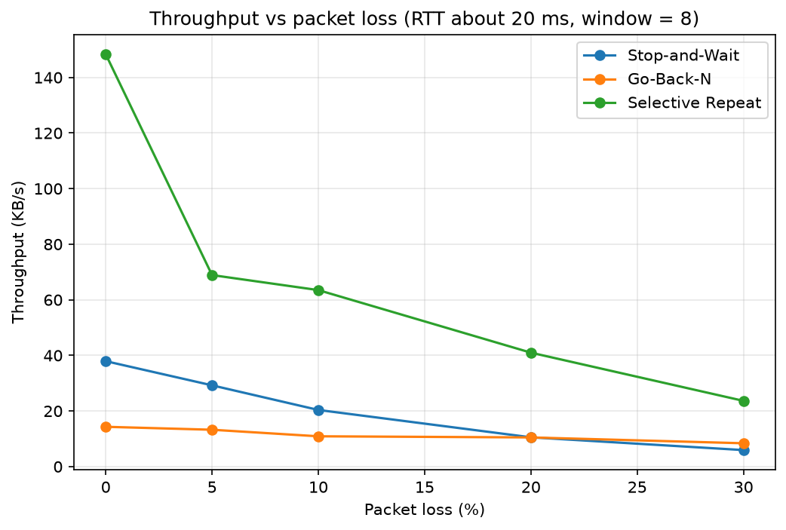
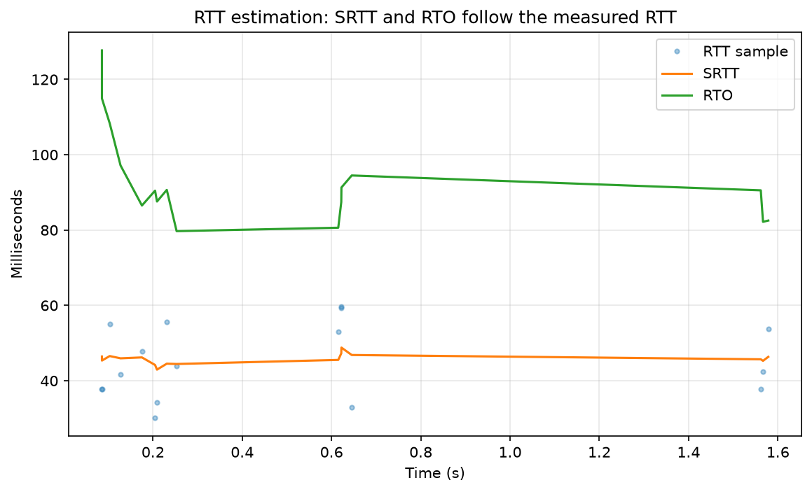
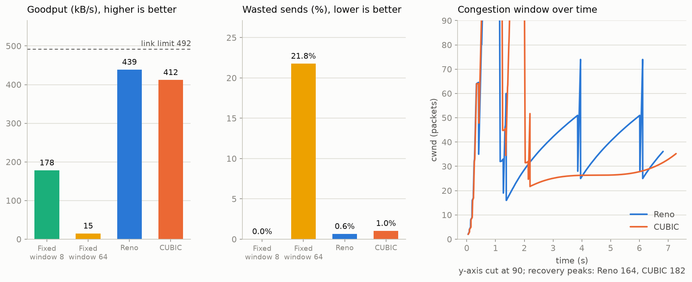
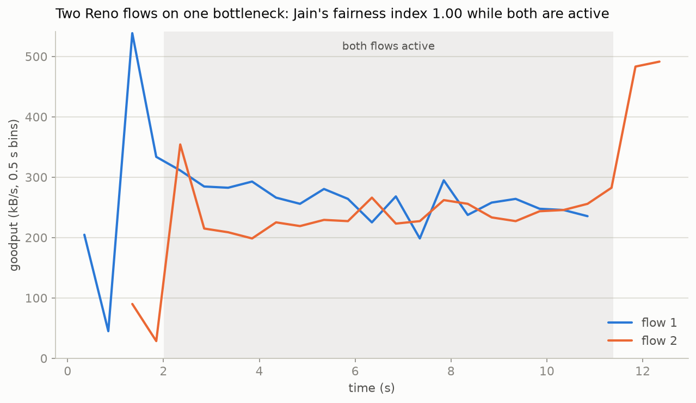
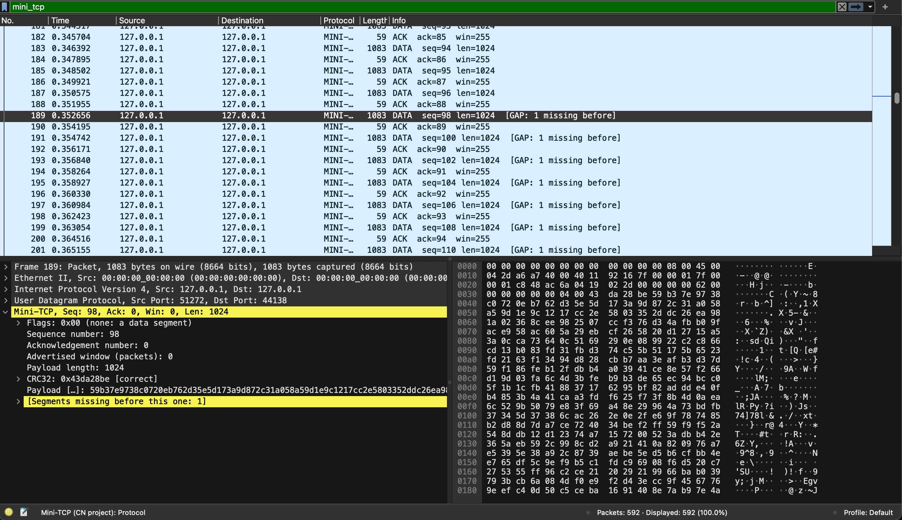

# Mini-TCP: building TCP's core ideas on top of UDP


A reliable, congestion-controlled transport protocol written from scratch in Python on
top of UDP sockets, with a small network emulator and experiments that measure it.

I built it to understand what TCP actually does. Instead of using TCP, I rebuilt the hard
parts (reliability, RTT estimation, flow control, congestion control) and tested each one
against a deliberately bad network.



*Reno's congestion window (top) and the bottleneck queue (bottom). The window grows until
the 30-packet buffer overflows, packets drop, and the window halves.*

## Contents

- [Features by phase](#features-by-phase)
- [Quick start](#quick-start)
- [Packet format](#packet-format)
- [Results](#results)
- [Wireshark dissector](#wireshark-dissector)
- [Bugs I hit and fixed](#bugs-i-hit-and-fixed)
- [Project layout](#project-layout)
- [Limitations](#limitations)
- [Next steps](#next-steps)
- [License](#license)

## Features by phase

| Phase | Goal | Features |
|---|---|---|
| **Foundations** | Send bytes over UDP and simulate a bad network | UDP sockets, packet header, CRC32 checksum, loss / corruption / delay emulation |
| **1. Reliable transfer** | Make a file arrive intact over an unreliable network | Sequence numbers, ACKs, timeouts, retransmission, Stop-and-Wait |
| **1b. Sliding windows** | Keep many packets in flight | Pipelining, Go-Back-N, Selective Repeat, cumulative ACKs |
| **2. TCP-like features** | Add what makes TCP, TCP | Three-way handshake, FIN teardown with TIME_WAIT, RTT estimation (SRTT, RTTVAR, RTO per RFC 6298), Karn's algorithm, exponential backoff, fast retransmit, flow control |
| **3. Congestion control** | Stop overloading the network, not just the receiver | Bottleneck emulator, slow start, congestion avoidance (AIMD), Reno, NewReno fast recovery, CUBIC, fairness measurement |
| **5. Wireshark dissector** | See the protocol on the wire | Lua dissector that decodes the header, checks the CRC and flags duplicate ACKs, gaps and corrupted packets |

## Quick start

Requires Python 3 (developed on 3.13). The only dependency is matplotlib, for the charts.

```bash
git clone https://github.com/TanayJoshi-XR/mini-tcp.git
cd mini-tcp

python3 -m venv .venv
source .venv/bin/activate
pip install -r requirements.txt

python -m tests.test_congestion     # unit tests, no network needed
python -m tests.cc_demo             # end-to-end transfers (about 30 s)
./run_all.sh                        # every experiment; charts saved to results/
```

Run a single experiment:

```bash
python -m experiments.cwnd_plot         # Reno sawtooth plus queue graph
python -m experiments.cc_compare        # fixed windows vs Reno vs CUBIC
python -m experiments.fairness          # two flows sharing one link
python -m experiments.compare_protocols # Stop-and-Wait vs Go-Back-N vs Selective Repeat
python -m experiments.rto_plot          # adaptive timeout
```

Every demo checks that the received file is byte-for-byte identical to the one sent.

## Packet format

```
 flags(1)  seq(4)  ack(4)  window(2)  length(2)  CRC32(4)  | payload (up to 1024 bytes)
```

- `flags`: SYN, ACK, FIN bits
- `seq` / `ack`: counted in packets (not bytes). `ack` is cumulative: "I have everything below this"
- `window`: free receive-buffer slots (flow control)
- `CRC32` covers the header and payload. Damaged packets are dropped

## Results

Everything below was measured on one laptop using the emulators in this repo. Absolute
numbers depend on the machine, but the shapes were reproducible across runs.

### Phase 1b: sliding windows (RTT about 20 ms, window 8)



Selective Repeat was best at every loss rate (about 148 KB/s with no loss, against 38 for
Stop-and-Wait). Go-Back-N was unexpectedly the slowest at low loss (about 14 KB/s even
with no loss), roughly level with Stop-and-Wait at 20% loss and slightly above it at 30%.
The slowness at zero loss comes from reordering: the emulator releases each delayed packet
from its own timer thread, so packets can overtake each other even with no loss, and
Go-Back-N's receiver discards anything that is not the exact next packet. Each discard
costs a full timeout and a resend of the window. I checked this directly: with the delay
set to 0 (no timer threads) Go-Back-N made no retransmits at zero loss, and with a 10 ms
delay it made hundreds. Selective Repeat buffers out-of-order packets, so it is unaffected.
At high loss, waiting for a full timeout before resending adds to the cost; fast
retransmit (Phase 2) is the standard fix.

### Phase 2: adaptive timeout



The fixed timeout of Phase 1 is replaced by an RTO computed from measured round trips.
Transfers complete correctly up to 30% packet loss. Fast retransmit cut transfer time by
roughly 14% at 10% loss. Flow control was checked with a slow reader: the sender was held
to the reader's pace by the window field alone.

### Phase 3: congestion control on a bottleneck

Emulated path: 4 Mbit/s, 40 ms round trip, 30-packet drop-tail buffer. The link can carry
about 492 kB/s of payload.



| Sender | Goodput | Notes |
|---|---|---|
| Fixed window 8 | about 180-190 kB/s | too small, link mostly idle |
| Fixed window 64 | about 15 kB/s | too large, constant overflow, 22% of sends wasted |
| Reno (NewReno) | about 440-460 kB/s | about 90-93% of the link |
| CUBIC | about 410-420 kB/s | similar to Reno at this RTT (see limitations) |

Two Reno flows sharing the link split it almost equally (Jain's fairness index 0.97 and
0.997 in two runs):



## Wireshark dissector

`wireshark/mini_tcp.lua` teaches Wireshark the Mini-TCP header, so captures of a transfer are
decoded instead of showing as anonymous UDP. It recognises our packets automatically, checks
the CRC32, and flags duplicate ACKs, sequence gaps, late retransmissions and corrupted packets.
Two sample captures are included, so you can open them without capturing anything.

```
  1   SYN  seq=0
  2   SYN,ACK  seq=0  ack=0  win=256
  3   ACK  ack=0  win=0
  4   DATA  seq=0 len=1024
  ...
189   DATA  seq=98 len=1024  [GAP: 1 missing before]
208   ACK  ack=97  win=255  [Dup ACK #1]
212   ACK  ack=97  win=253  [Dup ACK #3]
287   DATA  seq=97 len=1024  [Late: fills earlier gap]
```



The capture above is the 300 kB Reno transfer: slow start, a buffer overflow that drops
`seq=97`, the duplicate ACKs it causes, and the retransmission. The dissector finds exactly the
16 gaps that the emulator reported as drops. A step-by-step beginner guide is in
[wireshark/README.md](wireshark/README.md).

## Bugs I hit and fixed

- **Last-ACK problem.** If the final ACK is lost the sender never learns the transfer
  finished. Fixed with a proper FIN / FIN-ACK / ACK close and a TIME_WAIT-style linger.
- **Duplicate-ACK counting broke when the advertised window changed.** I required the
  window field to be unchanged, but it shrinks as out-of-order packets are buffered, so
  fast retransmit never fired. Fixed the condition.
- **Karn's algorithm starved the RTT estimator at high loss.** Almost every ACK covered a
  retransmitted packet, so no samples were taken and the RTO stayed pinned at its maximum
  (30% loss took 89 s). Fixed by recomputing the RTO when forward progress is made.
- **Slow-start overshoot.** With no threshold, the window blindly doubled to about 175
  packets on a path holding about 49, losing a burst of packets and taking seconds to
  recover. Fixed with an initial ssthresh of 64 packets.

## Project layout

```
protocol/      packet formats, RTT estimator, Reno and CUBIC, the mini-TCP sender/receiver
experiments/   bottleneck link emulator, comparisons and plots
tests/         unit tests and end-to-end demos
results/       generated charts
wireshark/     Wireshark dissector, sample captures and a beginner guide
run_all.sh     runs every experiment
```

## Limitations

- The "network" is a Python emulator on loopback, not real hardware. Timing is
  approximate, and Python threads add jitter.
- No SACK: NewReno repairs one lost packet per round trip, so it trails Selective Repeat
  at high loss.
- CUBIC is simplified. At this short RTT and small window the RFC's Reno-friendly term
  dominates, so the plots use the pure cubic curve (`tcp_friendly=False`). CUBIC's real
  advantage shows on long, fat paths, which this setup does not test.
- During fast recovery the congestion window is temporarily inflated (the spikes in the
  sawtooth plot). That is standard NewReno behaviour, not extra capacity.
- Sequence numbers count packets, there is one connection per transfer, and there is no
  encryption.

## Next steps

- Add selective acknowledgements (SACK)

## License

MIT, see [LICENSE](LICENSE).
